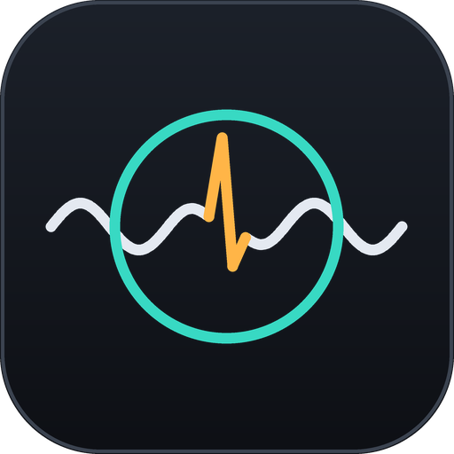
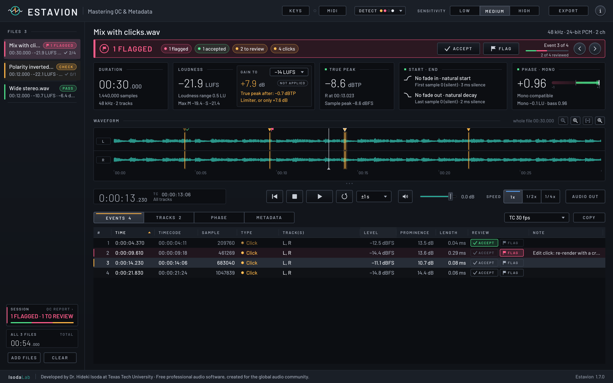
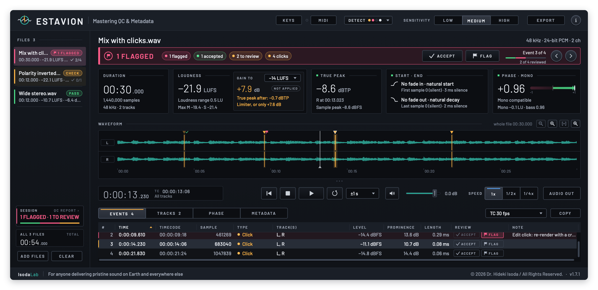
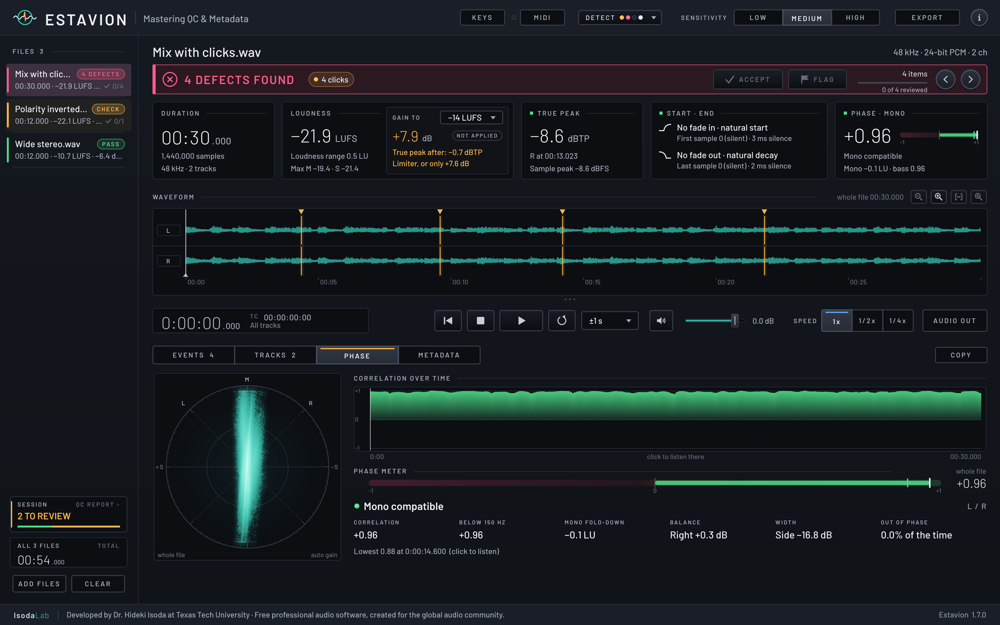
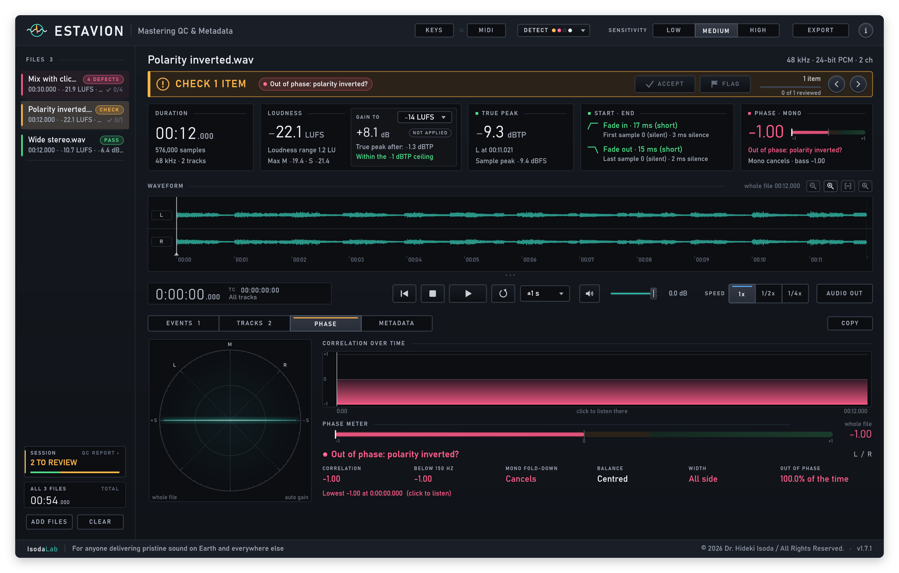
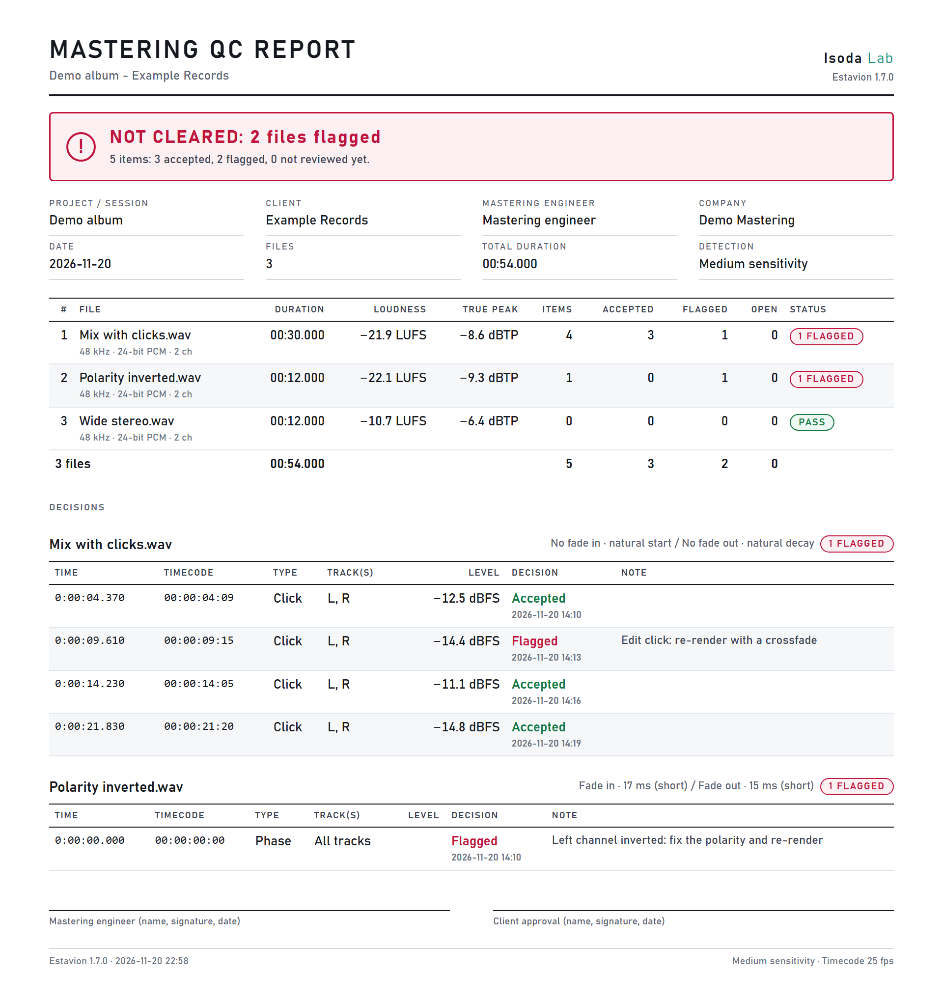
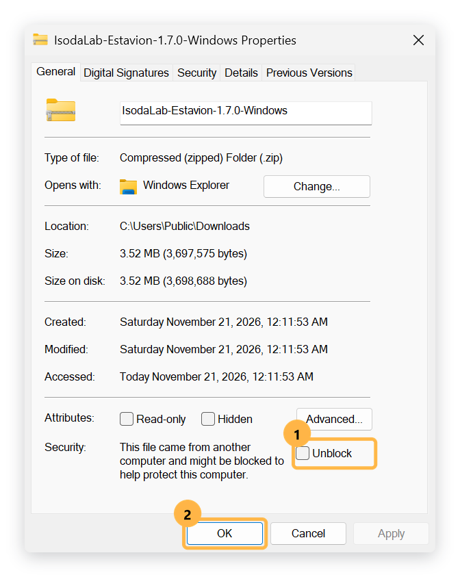
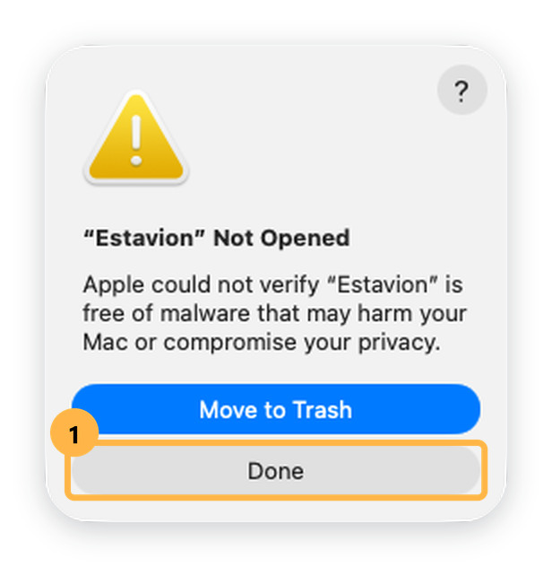
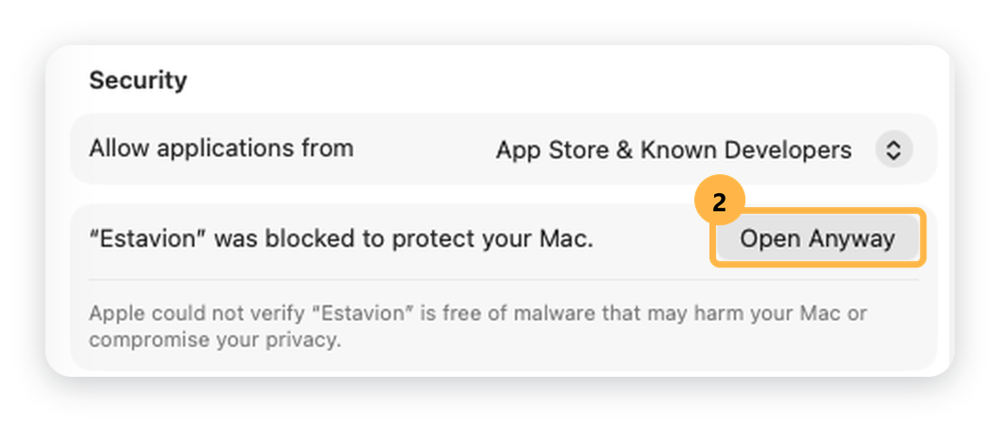

<p align="center">
  
</p>

<h1 align="center">Estavion</h1>
<p align="center"><b>Mastering QC &amp; Metadata</b><br>
IsodaLab<br>
<i>Free professional audio software, created for the global audio community.</i></p>

<p align="center">
  <a href="https://github.com/isodalab/estavion/releases/tag/v1.7.0"><b>Download 1.7.0</b></a> ·
  <a href="#install-on-windows">Install on Windows</a> ·
  <a href="#install-on-macos">Install on macOS</a> ·
  <a href="#install-on-linux">Install on Linux</a> ·
  <a href="#what-it-does">What it does</a>
</p>

<p align="center">
  
</p>

**Estavion is free, standalone software for checking audio files before you deliver them, and for documenting that they are ready.** Drop in files or whole folders: Estavion finds clicks, spikes, clipping and other digital and electrical noise and tells you when and on which track they happen, measures loudness and true peak, checks phase and mono compatibility and how each file starts and ends, and shows (and lets you edit) everything embedded in the file. You listen to every finding, accept it or flag it, and hand the client a QC report that shows the session is cleared.

It runs on **Windows**, **macOS** (Apple silicon) and **Linux**, with the same analysis, review and reports on all three.

<p align="center">
  
</p>

## Download

| Platform | Package | Requirements |
|---|---|---|
| **Windows** | [IsodaLab-Estavion-1.7.0-Windows.zip](https://github.com/isodalab/estavion/releases/download/v1.7.0/IsodaLab-Estavion-1.7.0-Windows.zip) | 64-bit Windows 10 or 11 |
| **macOS** | [IsodaLab-Estavion-1.7.0-macOS-AppleSilicon.dmg](https://github.com/isodalab/estavion/releases/download/v1.7.0/IsodaLab-Estavion-1.7.0-macOS-AppleSilicon.dmg) | Mac with Apple silicon (M1 or later), macOS 11 or later |
| **Linux** | [IsodaLab-Estavion-1.7.0-Linux-x86_64.zip](https://github.com/isodalab/estavion/releases/download/v1.7.0/IsodaLab-Estavion-1.7.0-Linux-x86_64.zip) | 64-bit Linux (x86_64), glibc 2.35 or later (Ubuntu 22.04+, Debian 12, Fedora 36+, …), ALSA or JACK audio |

Every package contains the app, the Quick Start guide and the license. [SHA256SUMS.txt](https://github.com/isodalab/estavion/releases/download/v1.7.0/SHA256SUMS.txt) lists the checksums. Estavion is a standalone app: there is no installer, no account and no license key. The full guide is inside the app: click **(i)** or press **Ctrl+/** (**Cmd+/** on a Mac).

## What it does

- **Finds digital and electrical noise.** Clicks, spikes and clipping (and, if you want them, low-frequency pops), with the time, SMPTE timecode, sample number and the track(s) each one is on. It tells digital defects apart from sounds in the room: page turns, breaths, consonants and chairs are not reported.
- **You choose what to look for.** DETECT turns each event type and each file check on or off. Pops are off by default, because kick drums and plosives look like them.
- **Review and sign-off.** Listen to each finding in a loop, at full, half or quarter speed, then **Accept** (A) or **Flag** (F) it, one at a time or many at once, with notes. The next finding to review is selected for you. The session box shows when every file is cleared.
- **QC report for the client.** The session status, every file and every decision with its time, timecode and note, and signature lines for the engineer and the client. Print it, save it as PDF, or export CSV.
- **Loudness and true peak.** Integrated loudness (ITU-R BS.1770-4 / EBU R128), loudness range, maximum momentary and short-term loudness, 4× oversampled true peak, and the gain to −14, −16, −18, −20 or −23 LUFS with a true-peak check (a suggestion: Estavion never changes your audio).
- **Phase and mono compatibility.** Correlation of the whole file and of the low end, the loudness lost in the mono fold-down, balance and width, a phosphor-style goniometer with auto gain, a phase meter and the correlation over time. While you play, the meters follow what you hear.
- **Start and end.** Whether a fade was applied and how long it is, a short anti-click ramp, an abrupt edge that will click, or a natural start and decay. It also says whether the first and last samples are silent, and how much silence (and digital silence) there is before and after.
- **Everything embedded, editable.** Broadcast Wave (bext), iXML, cue points and markers, LIST INFO, ID3, ADM and more. Edit tags, BWF and iXML fields and write them back: the audio is copied bit for bit and every other chunk is kept.
- **Cue sheets.** Print or save as PDF, CD cue sheets (.cue) for CD and DDP authoring, and CSV, from a list of files or the markers of one file.
- **Reads what you deliver.** WAV, BWF, RF64, BW64 and AIFF directly, at any sample rate and bit depth, with any number of tracks; MP3, AAC, FLAC, Ogg and the audio of video files are decoded first.
- **Hands on the controls.** Assignable keyboard shortcuts that work on any laptop keyboard (no Fn, Home or keypad needed), and MIDI Learn for any controller: review a whole session from a pad controller.

<p align="center">
  
</p>

<p align="center">
  
</p>

<p align="center">
  
</p>

## Install on Windows

1. **Unblock the download.** Right-click the ZIP → **Properties**. At the bottom of the *General* tab, tick **Unblock** (1), then click **OK** (2). Do this *before* extracting.

   <p align="center"></p>

2. **Extract.** Right-click the ZIP → **Extract All…**, and put the folder wherever you like (for example in *Documents* or *C:\Program Files*).
3. **Run `Estavion.exe`.** That's all: the whole program is this one file. Pin it to the taskbar or Start if you like. To open files, drop them on the window or on `Estavion.exe`.

<details>
<summary><b>If Windows or your browser blocks it</b></summary>

Estavion is free and isn't code-signed with a paid certificate, so Windows treats it as *unrecognized*. It contains no network code and collects no data.

| What you see | What to do |
|---|---|
| **Edge:** "…isn't commonly downloaded" | Hover over the download, click **…** → **Keep** → **Show more** → **Keep anyway**. |
| **Chrome:** "Suspicious download" | Click **Keep** in the downloads list. |
| **"Windows protected your PC"** (SmartScreen) when you run it | Click **More info**, then **Run anyway**. Windows asks only the first time. |
| Your antivirus quarantines `Estavion.exe` | Restore it and add an exception for it. |
| **Smart App Control** (Windows 11) refuses to run it | Smart App Control can block unsigned apps and has no override. The only way around it is to switch it off under *Windows Security → App & browser control → Smart App Control settings*. On many Windows 11 versions it can't be switched back on without resetting Windows, so weigh that before you do it. |

</details>

## Install on macOS

1. **Download** `IsodaLab-Estavion-1.7.0-macOS-AppleSilicon.dmg` and double-click it.
2. **Drag `Estavion.app` to your Applications folder.**
3. **Open it.** The first time, macOS shows an alert saying *"Estavion" Not Opened*. That's expected: Estavion is free and isn't notarized with a paid Apple Developer ID. Click **Done** (1), not *Move to Trash*.

   <p align="center"></p>

4. **Open System Settings → Privacy & Security** and scroll down to **Security**. Next to *"Estavion" was blocked to protect your Mac*, click **Open Anyway** (2). Enter your password (or use Touch ID) and confirm with **Open Anyway**. macOS remembers this: from now on Estavion opens normally.

   <p align="center"></p>

<details>
<summary><b>If macOS says the app is damaged</b></summary>

Some browsers and download tools mark the file so strictly that macOS reports it as *damaged* instead of offering *Open Anyway*. Open **Terminal** and run:

```bash
xattr -dr com.apple.quarantine /Applications/Estavion.app
```

Then open Estavion again.

</details>

## Install on Linux

1. **Extract** the download with your file manager, or in a terminal:

   ```bash
   unzip IsodaLab-Estavion-1.7.0-Linux-x86_64.zip
   ```

2. **Run it**, or add it to your applications menu:

   ```bash
   cd IsodaLab-Estavion-1.7.0-Linux-x86_64
   ./Estavion            # run it from here
   ./install.sh          # or: install for this user (~/.local/bin and the menu)
   ```

   No root password is needed. If your file manager dropped the executable bit, run `chmod +x Estavion install.sh` first. `./Estavion --version` prints the version and the copyright notice.
3. **Optional: install ffmpeg** (for example `sudo apt install ffmpeg`) to open AAC / M4A files and the audio of video files. WAV, BWF, AIFF, FLAC, Ogg and MP3 open without it.

Estavion plays through ALSA (or JACK); choose the device under **AUDIO OUT**. MIDI Learn reads controllers that appear as ALSA MIDI devices.

## Using Estavion

Shortcuts are written for Windows and Linux; on a Mac, use **Cmd** where they say Ctrl. Every default works on a laptop keyboard.

1. **Drop files or folders** on the window (or ADD FILES, Ctrl+O). Each file is analyzed in the background.
2. **Click a file.** The banner gives the verdict; **N** and **P** step through what was found; **Space** plays; **Enter** loops the selected event.
3. **Listen, then press A (accept) or F (flag).** The next finding is selected for you. Ctrl+click (Cmd+click on a Mac) or Shift+click to accept or flag several at once.
4. **Check the summary tiles:** loudness and the gain to your target, true peak, start and end, phase and mono.
5. **When the SESSION box says ALL FILES CLEARED,** print the QC report (Ctrl+R) for the client.

The [Quick Start](https://github.com/isodalab/estavion/releases/tag/v1.7.0) in every package and the guide inside the app (**Ctrl+/**) explain every feature.

## Privacy

Estavion collects no data. It makes no network connections, has no analytics or telemetry, and needs no account, registration or license key. It reads the files you open, writes only what you save or export, and plays audio and reads MIDI only on your own computer. A printed cue sheet or QC report is a temporary file opened in your own web browser.

## License

Estavion is **freeware**: free for personal, educational and commercial use on any number of computers. You're welcome to share the unmodified packages with anyone, free of charge, with the license and copyright notice intact. It is not open source. The full terms are in [LICENSE.txt](LICENSE.txt).

Built with the [JUCE](https://juce.com) framework. The macOS and Linux versions embed the Barlow typeface (SIL Open Font License 1.1). Windows is a trademark of Microsoft Corporation; macOS of Apple Inc.; Linux is a registered trademark of Linus Torvalds.

## About

For a long time, I dreamed of having a tool like this for my daily mixing and mastering work. You can do the job by combining several different tools, but Estavion makes my workflow much better and faster. I used to play an entire track through just to measure its integrated LUFS. Now the result is instant. Estavion also catches glitches in the source material before I start editing, mixing, or mastering.

I created this software as a contribution to the global audio community, and it is free for audio professionals, educators, students, and researchers worldwide.

This project is entirely self-funded, and I have not applied for any grants. I also see it as a good example for the Music Informatics and Recording Technology courses I teach at Texas Tech University School of Music, and I hope it inspires my students.

## Name

Estavion is a name I made up, blending two parts. "Estav" suggests stability and precision, and "ion" points to science and technology.

## Transparency

I do use AI tools like ChatGPT or Claude to help organize my ideas and catch errors, but most of the work comes from decades of coding practice and real-world professional experiences. I still design programs like this the old-fashioned way, with notebooks and a whiteboard, before the code takes shape. That said, AI has cut my build time from many months of late nights to weeks!

## Thank you

To my fantastic students and colleagues, who were so willing to test Estavion.

And to my wife, **Hyejin**, who is always supportive of me and my projects.

— Hideki Isoda

<sub>© 2026 Dr. Hideki Isoda / All Rights Reserved.</sub>
